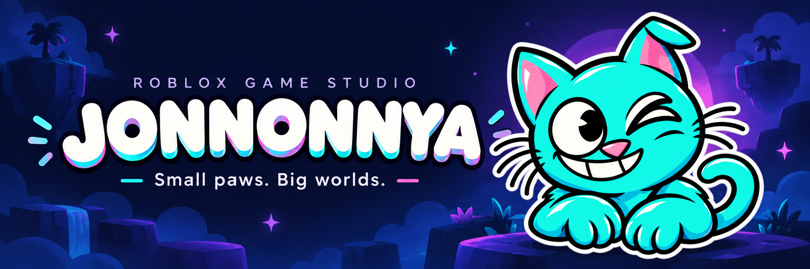
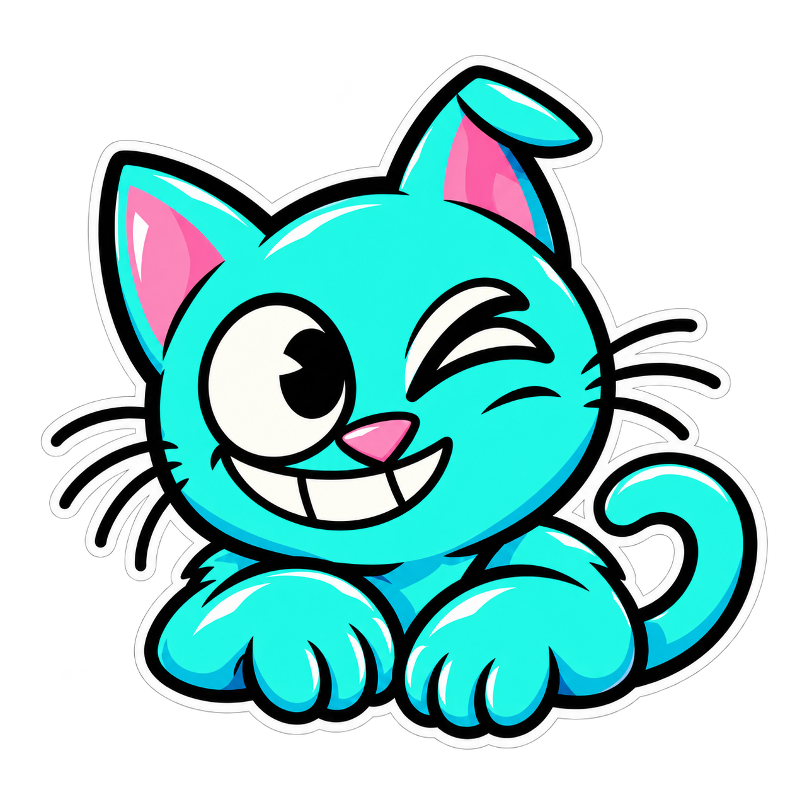

**Playful ideas. Worlds with personality. Adventures worth sharing.**

  <code>ROBLOX STUDIO</code> &nbsp; <code>LUAU</code> &nbsp; <code>GAME DESIGN</code> &nbsp; <code>WORLD BUILDING</code>

 

## 🐾 A little curious. A lot imaginative.

**JONNONNYA is a Roblox game development studio with a playful spirit and a love for building worlds.**

We turn small sparks of imagination into places to explore, challenges to take on, and moments to share with friends. Our goal is simple: make the first few minutes exciting, and give every return visit something to look forward to.

 

## ✦ What makes a JONNONNYA world?

<table>
  <tr>
    <td width="50%" valign="top">
      <h3>🎮 Fun at the core</h3>
      Clear rules, responsive controls, and choices that make you want to try one more time.
    </td>
    <td width="50%" valign="top">
      <h3>🌌 A world with character</h3>
      Expressive art, thoughtful details, and an atmosphere that feels like part of the adventure.
    </td>
  </tr>
  <tr>
    <td width="50%" valign="top">
      <h3>🤝 Better together</h3>
      Room for shared discoveries, friendly competition, and stories that outlast a play session.
    </td>
    <td width="50%" valign="top">
      <h3>✨ Care in every detail</h3>
      We aim to listen, test, and refine—from the biggest gameplay idea to the smallest interaction.
    </td>
  </tr>
</table>

 

## 🛠️ From a spark to a playable world

**Imagine → Prototype → Playtest → Refine**

We start with a moment worth playing, build around it, and let hands-on feedback guide what comes next.

---

### Small paws. Big worlds.

**JONNONNYA · Roblox Game Studio**

*Stay curious. Keep creating. Let's play.*

